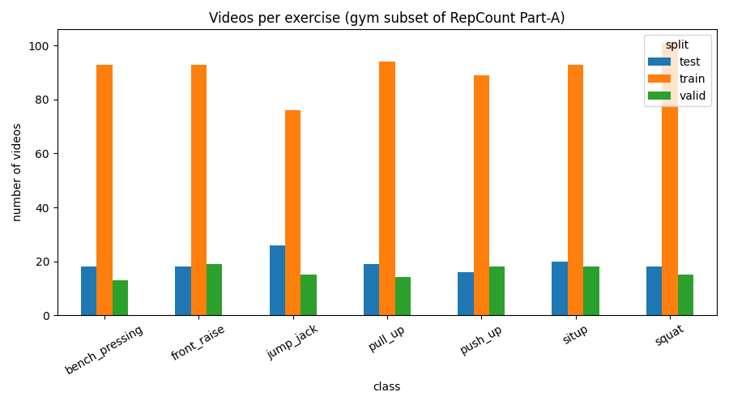
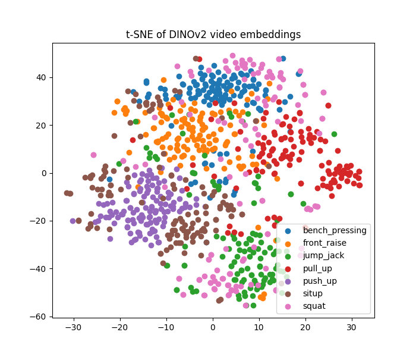
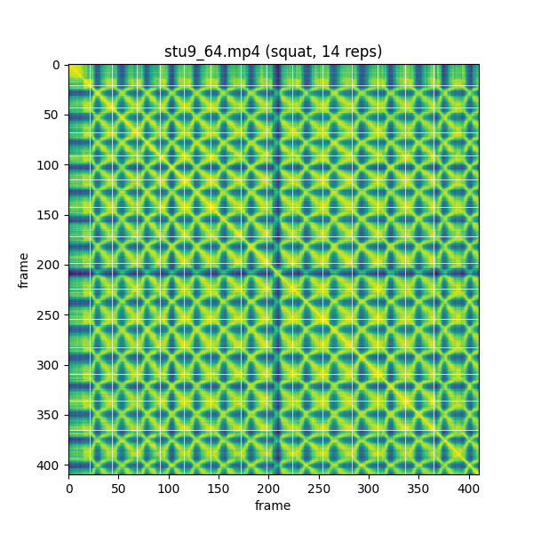

# Part 1: Conceptual Design

### Introduction and Project Goals:
The goal of our project is to effectively capture and assess exercise movements to provide holistic feedback. A tool that detects exercises in the gym, specifically weighted movements using dumbbells or machines, would serve as an effective way for athletes, gym rats, and even individuals new to the gym to get real-time feedback on their form, allowing them to workout more effectively and minimize injury risk. Our project consists of two primary objectives to build such a tool:
1) Exercise Recognition: Accurately detect & classify a performed exercise in an RGB video
2) Form Evaluation/Feedback: Compare individual exercise repetition to movement patterns in an baseline video (indicative of excellent form for the specific exercise in focus). Our tool will then output a holistic score evaluating one's form, along with specific feedback focusing on different aspects of exercise form, such as range of motion, body (arms, legs, etc) positioning, repetition speed, etc.

### Technical Approach:
Since our project consists of two team members, we plan on conducting two approaches. This will provide both of us with more CV experience, while allowing us to weight the benefits and differences of approaching a problem through two methods.
1) Approach 1 (MediaPipe + a Transformer): Our first approach is to utilize MediaPipe to continuously detect skeletal key points (between 20 to 30 joints in the human body), such as the shoulders, elbows, and knees, to name a few. This approach will then implement either an RNN or a transformer to predict the trajectories of the selected key points. Since these predictions follow the predicted trajectories of joints, this approach allows our model to detect precise form faults by measuring joint movement and angles at any given moment. 
2) Approach 2 (Direct Embeddings via a Foundational Model): The second approach we plan on utilizing will implement a foundational model to ingest the spatial and temporal dimensions of video data. Instead of detecting key points, high-dimensional embeddings will be used by this approach to capture human movement speed, spatial-temporal movement gradients, equipment paths (the trajectories of dumbbells, machines, or barbells), and muscle/joint contours. While this approach doesn't allow for us to detect precise form faults through key point tracking, interpreting the video feed by using embeddings allow the model to identify form faults that key points can't. For example, if both arm's cross each other in an incorrect manner while performing an exercise, the foundational model will be able to detect the incorrect form whereas key points would disregard such an occurrence.

When building out either approach, there are multiple factors that the model needs to be agnostic to. First, the aesthetic settings (lighting, shadows, colors, and exposures) found in any gym, or even in any section of a gym (the machine sections, cardio sections, and free weights sections), will greatly vary. These differences shouldn't impact the model's interpretation of the video data. Second, the model needs to be agnostic to the subject's appearance and outfit. Gym attire drastically ranges from everyday t-shirts to tank tops, all the way to baggy hoodies and sweatshirts. Regardless of what the subject decides to wear to the gym, our model needs to be able to accurately assess key points (approach 1) or muscle contours and gradients (approach 2). Another key factor that our model has to be agnostic to is the video's background. If the subject is performing a recorded exercise and another gym-goer steps into the background, the model needs to be able to only focus on the subject without diverting its attention to other people in the video. Lastly, our model needs to be agnostic to variations in the camera settings, whether it be the zoom of the camera or the angle of the video frame. 

### Data:
For our project, we plan on using the Repetition Action Counting Dataset: https://svip-lab.github.io/dataset/RepCount_dataset.html. This dataset consists of 1451 videos of individuals that are exercising. 1,041 videos are from YouTube and the remaining 410 videos are of volunteers at a local school who performed exercises for data collection purposes. The exercises included in the dataset are vast, ranging from pull-ups to squats. This dataset consists of annotations that label the start and end of an exercise repetition, along with the exercise's classification (exercise name). We plan on using this dataset for both approaches, ensuring consistency across our models. We also plan on creating an effective train-validation-test split of about 70%-15%-15%. This way, we will train both models on 70% of the data, use the 15% validation split to fine-tune the models' hyperparameters, and utilize the final 15% test data to assess the final effectiveness of the models. The exact split will be discussed in part 2 on dataset collection.

### Team Member Contributions/Involvement:
1) Arnav Cherukuthota: Implement Approach 1 - MediaPipe for key point labeling, followed by an RNN to predict the movement trajectories of the key points. 
2) Michael Bai: Implement Approach 2 - Will select and implement a foundational model to extract embeddings, along with dataset curation.

Collective/Joint Contributions: After we implement our individual delegations, we will collectively compare the results of both approaches, focusing on overall accuracy as well as specific cases in which either model doesn't perform as expected. Some potential metrics that will help us assess effectiveness include precision, recall, and an F1 score. Additionally, before we start building out either approach, we will collectively define standard parameters for our models. This will consist of determining the standard frame rate and video resolution that we plan on using. This ensures data setting consistency across both approaches. Lastly, we will work together on tasks that require team collaboration. Uploading code and making changes to the GitHub repository, as well as project reports, deliverables, and the final presentation at the end of the semester are all examples of tasks that we will work together on.

### AI Transparency for Part 1: Conceptual Design
We used AI to help us brainstorm and get a better understanding of our project - However, we did not use AI in any other way, or to an any other extent. AI helped explain the different approaches and what they might look like, from the type of data factors we want to focus on (such as key points) to different models we could potentially consider using. The entirety of this report/ReadMe was handwritten by the two of us. 

# Part 2: Dataset Collection

### About
As stated in part 1 of the document, we plan on using the Repetition Action Counting Dataset provided by researchers at ShanghaiTech University located at the link  https://svip-lab.github.io/dataset/RepCount_dataset.html. The dataset, called "RepCount" contains a total of 1,451 videos with 1,041 coming from YouTube and 410 coming from researchers collecting data at a local school themselves. Actions contained in the videos depict physical activities, including workout activities such as sit-ups, squats and pull-ups, athletic events such as rowing and pommel horse, as well as other actions such as juggling a soccer ball. The videos vary significantly in length, ranging from 4 to 88 seconds (~29s on average), which provides us a more realistic setting that earlier datasets like UCFRep and Countix, whose videos are much shorter at around 6-8 seconds. The authors also deliberately included videos with interruptions, or so called "anomalys", such as rest periods and changes in pace, which makes counting harder, but also better reflects the nature of real workouts. Each repetition is labeled with its start and end frame and was labeled by two human volunteers, and the video was reviewed and corrected if their counts differed by more than one. This means that this data is ideal for supervised learning and can be used to check not just the correct total, but also whether or not a model finds the correct repetitions.

### Associated Paper
Hu, H., Dong, S., Zhao, Y., Lian, D., Li, Z., and Gao, S. "TransRAC: Encoding Multi-scale Temporal Correlation with Transformers for Repetitive Action Counting." CVPR 2022 (arXiv:2204.01018).

### Dataset Splits
Part-A, as defined by the researchers, is randomly divided into 758 training (~72.8%), 131 validation (~12.6%), and 152 (~14.6%) test videos. Part-B, in contrast, is used only for testing to measure how well a model generalizes. We will be using the same proposed split as the researchers intended, mentioned in the previous sentence. Being randomized, the training and validation sets are very similar, both averaging around 840 frames per video and share the same action types. Validation scores will tell us how well the model can count familiar exercises, but not how it can handle the detection of new exercises or environments. The validation split is also quite small, so results for individual exercise types may be noisy.

The paper also describes an alternative "open-set" split with the training, validation, and testing set containing completely different actions. This is a better test if we want our models to count exercises it has never seen, so we may also consider using this additional set to supplement our model.

Regarding part-B, which features different people and a different location than Part-A, which is derived from YouTube, we feel it is best to reserve Part-B strictly as a final generalization test.

### Data Composition
Videos are organized by action type and not by the individual subject. Therefore, the number of subjects is not reported. Most Part-A videos probably come from different YouTube uploaders. Part-B videos likely contain videos from the same couple student and teacher volunteers since they are collected locally. The paper does not list the number of videos per action type. We plan on writing a script top count this and check for class imbalance. Repetition counts range from 1 to 141 per video in Part-A with a mean of ~15 and from 1 to 32 in Part B with a mean of ~9.

### Sample Properties
Each sample is a video from a standard camera. There are no sensors used in the data. Because Part-A comes from YouTube, its resolution, frame rate, camera angle, lighting, quality, etc.. will vary from video to video, as well as its setting. The authors of the paper mention that additional people moving in the frame of some videos caused the model to perform worse. Part-B was filmed indoors at a local school with a more consistent setup.

### Team Member Contributions/Involvement:
Michael and Arnav contributed equally to the authorship of this section, meeting in person to both read the paper and brainstorm how to structure the contents of the section. The ideas represented from this section are collective thoughts from both Michael and Arnav.  Michael was responsible for the writing of this section.

# Part 3: First Update

## Implemented Methods

### Dataset Preprocessing

- We first read the RepCount Part-A annotation files (train, valid, test). Each row of the file lists the video name, its exercise type, its rep count, and the start and end frame of every repetition. We converted the frame labels into a list of (start, end) pairs, one per rep. For example, The first rep starts at L1 and ends at L2 for a total duration of that rep L2 - L1. Next, we had to deal with discrepancies regarding class naming. The dataset spells several exercises in more than one way (for example `pushups` and `push_up`, `benchpressing` and `bench_pressing`). In addition, it contains a typo (`squant` for `squat`). We mapped every variable spelling to a single, unified class name. In addition, we decided to remove the classes that are not typical gym exercises (`pommelhorse` and `others`), as well as videos with zero labeled reps. We also dropped `battle_rope`, which has only 16 videos and none in the test split, so it could not be evaluated. This left 886 videos across 7 different types of exercises.

### Approach 1: MediaPipe Keypoints (Arnav)

- TODO

### Approach 2: Foundation Model Embeddings (Michael)

- For Approach 2, we passed every sampled frame through Meta’s pre-trained DINOv2 model (`facebook/dinov2-small`), trained off of 142 million images. For each frame, we kept the model’s CLS token (classification token), which is a 384-number vector that summarizes the content of the whole frame. As a result, each video becomes a sequence of these vectors, one per sampled frame. For example, a 30-second video sampled at 10 frames per second yields 300 vectors. Next, to check whether these embeddings can tell exercises apart, we averaged each video’s frame embeddings into a single vector and used t-SNE to flatten the vectors’ dimensions and plot all of the videos into a 2D space, coloring each point by known exercise label. This lets us see whether videos of the same exercise group together, without training anything. Lastly, we computed a self-similarity matrix (SSM) for individual videos. To do this, we measured the cosine similarity between every pair of frame embeddings in a video and displayed the result as a heatmap. Because an exercise repeats the same movement over and over, the matching points of each rep should look alike, so the repetitions should show up as a repeating pattern in the heatmap.

## Justification

**Preprocessing:** Our project is about gym form feedback, so we only kept typical "gym" exercises. Cleaning up the class names was of course necessary because otherwise the same exercise would be split into several classes. We sampled frames at 10 fps because a body barely moves between neighboring frames, so keeping every frame is inefficient computationally and not very useful.

### Approach 1

TODO

### Approach 2

We chose a pre-trained foundation model so that we could get useful features without training anything ourselves. Because DINOv2 is trained on a large and varied set of images, we believe that it should be able to handle the differences in lighting, clothing, background, and other anomalies that were previously bought up.  We chose the smallest model because it seemed to be the best balance between have enough discriminatory power and respecting our laptop’s resources when it came to training. This also served as a sanity check to see whether a frozen foundation model holds exercise information at all before moving to a larger video model. Next, because the embeddings have 384 dimensions and can’t be plotted directly, we decided that t-SNE would be best for dimensionality reduction, flattening them into 2D, allowing us to visualize clusters that form naturally between exercise groups. Of course, this also gives us a simple way to see whether the embeddings separate exercises before even building a classifier. Finally, we used a self-similarity matrix because every exercise repeats the same movement, so frames from the same point in different reps should look alike. A ssm turns this into a visualizable repeating pattern. This is the same idea used in the research paper behind our dataset. We believe that the pre-classification exploration approaches listed in approach 2 support the fact that the dataset is suited well for classification.

## Results

### Class Distribution

After preprocessing, the 7 remaining exercises are fairly balanced. Each exercise has between 76 and 101 training videos and between 13 and 26 videos in each of the validation and test splits, so no single exercise is overrepresented. 

### Approach 1

TODO

### Approach 2

### **t-SNE of Video Embeddings**

 
Each point represents one video, and videos with similar embeddings naturally cluster near each other. Even without training, we can see that DINOv2 separates most of them into their own regions. Exercises with similar body positions have clusters that end up near each other (e.g push-ups and sit-ups, jump_jack and squat). 

There are some strange things of note regarding the separations though. For example, squats are the most scattered, likely because they were filmed in many different places and because averaging all frames into one vector loses the up-and-down motion. For exercises like that, we’d need to think about how to deal with this phenomenon.

### **Self-Similarity Matrix (Squat)**

 
This heatmap compares every sampled frame of a 14-rep squat video (`stu9_64.mp4`) to every other frame. Yellow means similar, dark blue means different, and the white grids mark the labeled rep starts. We can see that a clean, repeating pattern is formed, lining up pretty closely with the white grid labels. This shows that the embeddings signify repetitions without even undergoing any training. In addition, for each rep, the pattern is symmetrical, showing that for a squat, going down looks like coming up in reverse. Overall, this is an ideal example of a ssm for a well-defined exercise. For the next part of the project, we will generate more ssm plots for other exercises and anticipate having to deal with many anomalies.
